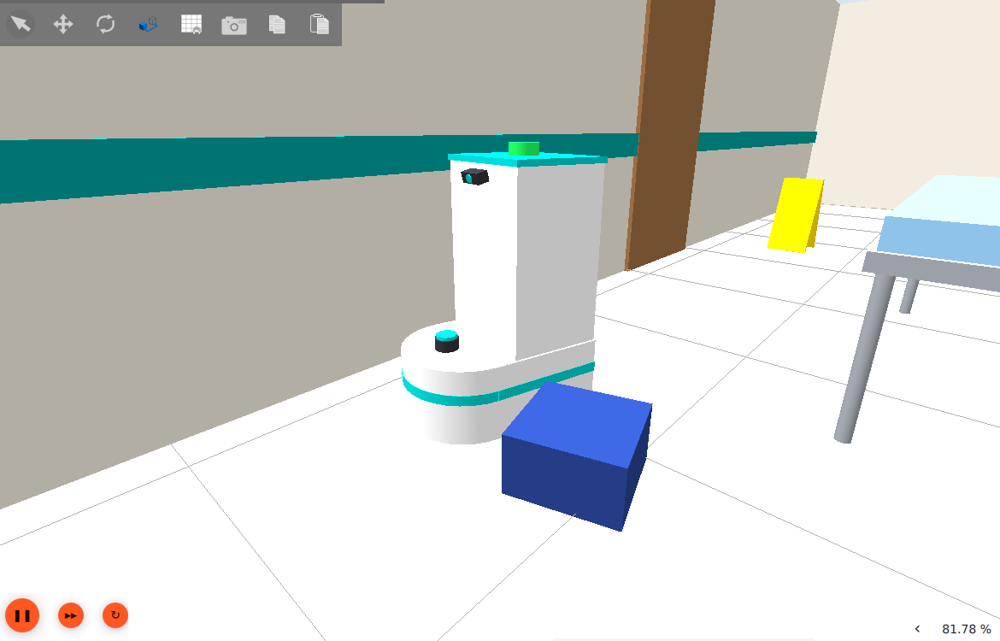
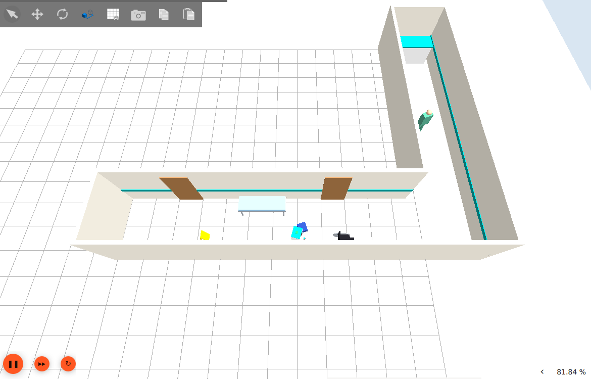
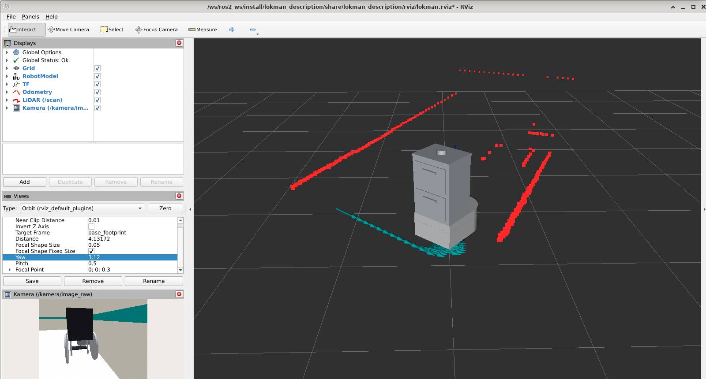
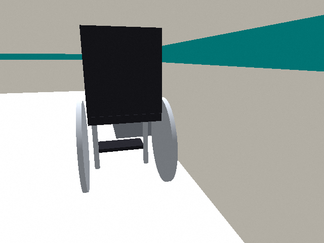

# LOKMAN – Hastane Koridoru Malzeme Taşıma Robotu

**BIMU4101 – Introduction to Mobile Robotics · Ara Sınav Projesi**

LOKMAN, hastane koridorlarında ilaç, numune tüpü ve steril malzeme taşımak için tasarladığımız diferansiyel sürüşlü bir mobil robot. Robotu URDF/Xacro ile sıfırdan modelledik, kendi hazırladığımız bir hastane koridoru dünyasında Gazebo ile simüle ettik ve ROS 2 ile kontrol ediyoruz.

İsmini Anadolu'daki şifacı figürü *Lokman Hekim*'den aldık.

<p align="center">
  
</p>

## Ekip

| Üye | Sensör sorumluluğu |
|---|---|
| Ahsen Yenisey | [belirlenecek] |
| Hüseyin Atay | [belirlenecek] |
| İsa Şebib | [belirlenecek] |
| Ortak | Bumper (temas sensörü) |

## Neden böyle bir robot?

Hastanelerde hemşirelerin vardiya boyunca önemli bir zamanı eczane, servis ve laboratuvar arasında malzeme taşımakla geçiyor. LOKMAN'ın görevi bu taşıma işini üstlenmek ve bunu yaparken koridordaki insanlara, sedyelere ve tekerlekli sandalyelere çarpmamak.

Tasarım kararlarını hep koridor ortamından yola çıkarak verdik:

- **Dar gövde (44 cm) ve yerinde dönebilme:** Kapılardan geçer, asansörde dönebilir.
- **Yarım daire şeklinde burun:** Çarpma anında keskin köşe yok. Duvara sürtünürse takılmadan kayar.
- **Alçağa yerleştirilmiş LiDAR (33 cm):** Sedye ayakları ve tekerlekli sandalye gibi alçak engelleri görebilsin diye.
- **Bel hizasında çekmeceler:** Hemşire eğilmeden yük koyup alabilsin diye.
- **Maksimum 0,4 m/s hız:** İnsan yürüyüşünden belirgin şekilde yavaş.

Bütün ölçüler, renkler ve sensör konumları gerekçeleriyle birlikte [`docs/tasarim.md`](docs/tasarim.md) dosyasında.

## Simülasyon dünyası

L şeklinde, 2,4 m genişliğinde bir hastane koridoru hazırladık. İçinde ıslak zemin levhası, sedye, devrik bir tabure, tekerlekli sandalye, bekleme sıraları, ayakta duran bir hemşire ve hemşire bankosu var. Bütün modeller basit geometrik şekillerden kendimiz oluşturduk, hazır model kullanmadık.

<p align="center">
  
</p>

Engelleri bilerek seçtik. Örneğin **sedyenin** yalnızca ince ayakları LiDAR'ın tarama yüksekliğine denk geliyor. **Devrik tabure** ise 20 cm yüksekliğinde, yani LiDAR'ın tarama düzleminin altında kalıyor. LiDAR onu göremiyor, bu yüzden bumper sensörüne ihtiyaç var.

## Sensörler

| Sensör | Konum | ROS 2 topic | Mesaj tipi | Görselleştirme |
|---|---|---|---|---|
| 2D LiDAR | Burnun üstü, yerden 0,33 m | `/scan` | `sensor_msgs/msg/LaserScan` | RViz |
| Kamera | Kabinin ön üstü, 0,86 m, 15° aşağı eğik | `/kamera/image_raw` | `sensor_msgs/msg/Image` | rqt_image_view, RViz |
| IMU | Gövde merkezi, tahrik aksının üstü | `/imu` | `sensor_msgs/msg/Imu` | rqt_plot |
| Bumper | Ön burun boyunca | `/bumper` | temas mesajı | terminal / RViz |

<p align="center">
  
</p>

*RViz görüntüsü: Kırmızı noktalar LiDAR'ın gördüğü duvarlar ve engeller, sol alttaki panel ise kamera görüntüsü.*

<p align="center">
  
</p>

*Robotun kamerasından görünen koridor.*

## Kurulum

Proje **ROS 2 Lyrical** ve **Gazebo Jetty** ile çalışıyor (Ubuntu 26.04). Herkesin bilgisayarında aynı ortamın olması için her şeyi bir Docker konteynerinin içinde çalıştırıyoruz. Gazebo ve RViz pencereleri tarayıcıdan (noVNC) açılıyor. Yani bilgisayarınıza ROS kurmanız gerekmiyor.

### Gerekenler

- **macOS:** [OrbStack](https://orbstack.dev) (veya Docker Desktop)
- **Windows:** [Docker Desktop](https://www.docker.com/products/docker-desktop/) (WSL 2 ile)
- Git

### Adımlar

```bash
git clone https://github.com/ahsenyenisey/lokman-hastane-robotu.git
cd lokman-hastane-robotu
```

**macOS / Linux:**
```bash
./baslat.sh
```

**Windows (PowerShell):**
```powershell
.\baslat.ps1
```

İlk çalıştırmada Docker imajı derleniyor. İnternet hızına göre 10–20 dakika sürebilir. Sonraki açılışlar birkaç saniye sürer. İşlem bitince tarayıcıda masaüstü açılır. Açılmazsa şu adrese gidin: http://localhost:6080/vnc.html

Tarayıcıdaki masaüstünde bir terminal açıp (**Applications → Terminal Emulator**) çalışma alanını derleyin. Bunu sadece ilk seferde ve kod değiştiğinde yapmanız yeterli:
```bash
cd /ws/ros2_ws
colcon build --symlink-install
source install/setup.bash
```

## Çalıştırma

**Simülasyon (Gazebo + robot + RViz tek komutla):**
```bash
ros2 launch lokman_gazebo lokman.launch.py
```

Ek seçenekler:
```bash
ros2 launch lokman_gazebo lokman.launch.py dunya:=empty.sdf          # boş dünyada test
ros2 launch lokman_gazebo lokman.launch.py x:=8.0 y:=0.0 yaw:=1.57   # başlangıç konumu
```

**Robotu ok tuşlarıyla sürmek** (ikinci bir terminalde):
```bash
ros2 run lokman_behavior ok_tuslari
```
↑ ↓ ← → ile sürülür, boşluk tuşu durdurur, `q` çıkar. Tuşu bırakınca robot kendiliğinden durur.

**Sensör verilerini kontrol etmek:**
```bash
ros2 topic list                          # bütün topic'ler
ros2 topic hz /scan                      # LiDAR yayın hızı
ros2 topic echo /scan --once             # tek bir LiDAR mesajı
ros2 run rqt_image_view rqt_image_view   # kamera görüntüsü
```

Simülasyonu kapatmak için launch komutunu çalıştırdığınız terminalde **Ctrl+C**'ye basın. Ortamı tamamen kapatmak için ana bilgisayarda `./durdur.sh` (Windows'ta `.\durdur.ps1`) çalıştırın.

## Proje yapısı

```
.
├── docker/                    # Docker ortamı (Ubuntu 26.04 + ROS 2 Lyrical + Gazebo Jetty + noVNC)
├── docker-compose.yml
├── baslat.sh / baslat.ps1     # ortamı başlatır
├── durdur.sh / durdur.ps1     # ortamı durdurur
├── terminal.sh / terminal.ps1 # konteynerin içinde terminal açar
├── docs/
│   ├── tasarim.md             # tasarım kararları ve gerekçeleri
│   └── img/                   # ekran görüntüleri
└── ros2_ws/src/
    ├── lokman_description/    # robot modeli (URDF/Xacro) ve RViz ayarı
    │   └── urdf/
    │       ├── lokman.urdf.xacro    # ana model dosyası
    │       ├── ortak.xacro          # renkler, eylemsizlik formülleri
    │       ├── chassis.xacro        # gövde, kabin, tekerlekler, caster'lar
    │       ├── surus.gazebo.xacro   # diferansiyel sürüş eklentisi
    │       └── lidar / camera / imu / bumper .xacro   # her sensör ayrı dosyada
    ├── lokman_gazebo/         # dünya, launch dosyası, Gazebo↔ROS köprü ayarları
    │   ├── worlds/hastane_koridoru.sdf
    │   ├── launch/lokman.launch.py
    │   └── config/kopru*.yaml
    └── lokman_behavior/       # Python düğümleri
        └── lokman_behavior/ok_tuslari.py
```

## Hareket sistemi

Diferansiyel sürüş kullanıyoruz. İki tahrikli tekerlek gövdenin ortasında aynı aks üzerinde duruyor, önde ve arkada birer sarhoş teker (caster) var. Bu sayede robot kendi ekseni etrafında dönebiliyor. Gazebo'nun `DiffDrive` eklentisi `/cmd_vel` topic'inden gelen hız komutunu teker hızlarına çeviriyor:

```
v_sol = v − ω · L/2
v_sağ = v + ω · L/2        (L = 0,36 m teker aralığı)
```

Ani kalkış ve frenlerde taşınan yük sarsılmasın diye eklentiye ivme sınırı da koyduk (0,8 m/s²).

## Bilinen sorunlar

- Konteynerde ekran kartı olmadığı için Gazebo görüntüyü işlemciyle çiziyor. Bu yüzden biraz yavaş çalışabilir. Varsayılan render motoru (Ogre2) bu durumda pencerenin donmasına yol açtığı için launch dosyasında daha hafif olan **Ogre1** motorunu seçtik.
- RViz'de robot modeli gri görünüyor (renkler yalnızca Gazebo'da görünüyor). Bu durum yazılımsal çizimle ilgili ve işlevi etkilemiyor.

## Durum

- [x] Docker tabanlı geliştirme ortamı
- [x] Robot modeli ve diferansiyel sürüş
- [x] Hastane koridoru dünyası ve tek launch dosyası
- [x] Ok tuşlarıyla sürüş
- [ ] Sensörler: LiDAR, kamera, IMU, bumper
- [ ] Sensör tabanlı davranış düğümü ("kibar koridor sürüşü")
- [ ] Rapor ve sunum
